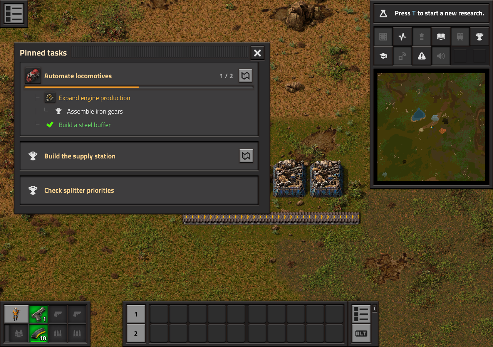
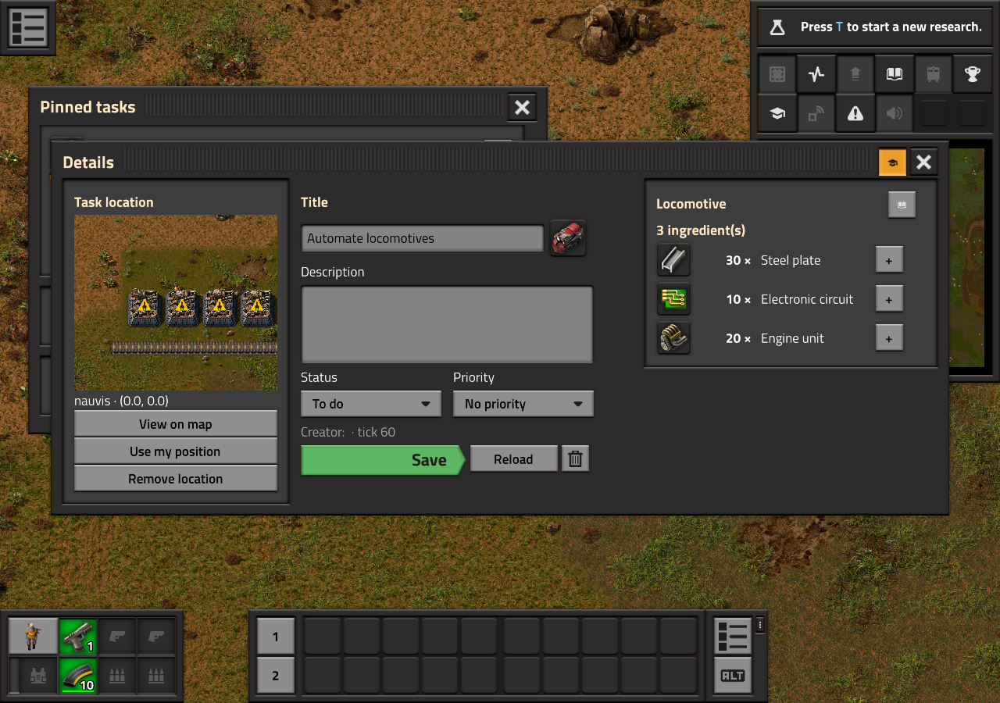
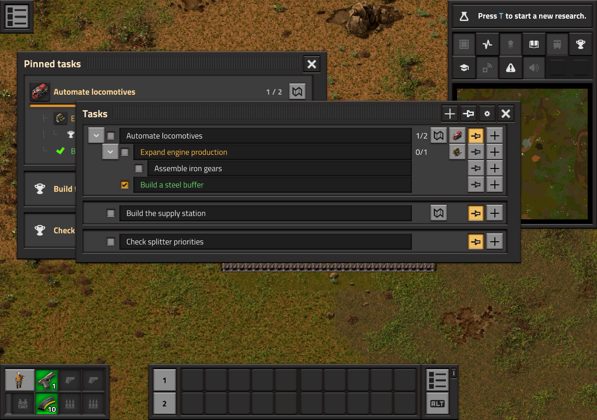

# Todo Manager

## Why another todo list?

Because planning your factory should be quick, even when you are browsing hundreds
of unfamiliar items and fluids.

**See a component you need? Turn its icon into a task.** Hover an item, fluid or
recipe icon and press **Ctrl + Shift + left-click**. It works wherever Factorio
exposes a hovered prototype, including either panel of Factoriopedia, your inventory
and mod interfaces. The task opens with the component already selected and its
localized name filled in. Add a note if needed, then save — no need to type the
component's name by hand. The shortcut is configurable in Factorio's controls.

**Need to remember something right here? Type `/todo Build a new station`.**
The task is created immediately with your current position and surface, and pinned
to your reminder. Keep building and come back to that exact spot later.

From there, organize your goals into subtasks and explore their recipe ingredients
one step at a time, while you stay in charge of your factory.

## Plan while you play

- Create a task with `/todo Build a new station`. Your current position and surface are saved automatically.
- Organize goals into tasks and subtasks, with notes, priorities and statuses.
- Pin individual tasks in a compact reminder with cards, hierarchy and progress. Pinning a parent does not pin its children.
- Click a reminder title or icon to open the task, including plain notes without an associated item.
- Preview a saved location and jump to it on the map.

## Turn recipes into next steps

Choose an item, fluid or recipe using Factorio's native selector and search.
Inspect its ingredients and add only the components you need as subtasks.
Expand each branch when you are ready: no entire production chain is generated automatically.

Alternative recipes remain your choice. Unresearched recipes appear in red and can
be hidden. A book button opens the selected recipe in Factoriopedia.

Quantities are theoretical; machines, productivity bonuses and factory balancing
are not simulated. Completing subtasks never automatically marks their parent as done.

## Your save keeps your plan

Tasks and preferences are stored inside the save and travel with it between computers.
Tasks are shared between players; pins, reminder width and visibility are personal.

- Requires **Factorio 2.1**.
- English and French interfaces.
- No required content mod, Todo List dependency or external service.
- Reads recipes and ingredients from the prototypes of installed mods.
- MIT license.
